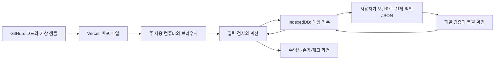

# 카페 판매·손익·재고 관리 기술 요구사항 문서

작성일: 2026-10-12  
상태: 추천 기술안으로 작성 완료. 이번 문서는 구현 설계이며 프로그램 개발·GitHub 업로드·Vercel 배포 완료를 뜻하지 않는다.  
TRD는 정해진 기능을 어떤 기술과 자료 구조로 만들고, 어떻게 저장·검사·배포할지를 설명하는 문서다.

## 1. 목적·근거·결정의 범위

한 매장·운영자 1명이 주 사용 컴퓨터 1대에서 판매·비용·재고를 관리하는 웹 프로그램을 만든다. 사용 순서는 판매 입력 → 메뉴 수익성 → 기간 손익 → 재료 잔량 확인이다. 코드는 GitHub에 보관하고 웹 프로그램은 Vercel에 배포한다.

검토한 자료는 `docs/01_PRD.md`, `docs/02_FRD.md`, `design/warm_cafe_operations/DESIGN.md`, `design/_1`~`design/_4`의 화면 이미지와 HTML이다. 초기 자료는 실습 폴더의 매장운영데이터 JSON이다. 엑셀과 JSON은 같은 기록이므로 함께 더하지 않는다.

사용자의 “TRD문서는 추천대로 하고 완료”에 따라 이 문서의 기술 선택은 추천안으로 결정한다. PRD·FRD 원문은 수정하지 않는다. FRD에서 **미확정**으로 적힌 계산식·업무 처리 기준을 기술 선택만으로 확정하거나 바꾸지 않는다. 구현 위치와 방식은 정하되, 해당 업무 기준의 미정 상태는 제13절에 그대로 남긴다. TRD 작성 완료와 업무 기준 최종 합의는 구분한다.

### 유지하는 제품 범위

- 제공 메뉴 8개·재료 11개와 기존 가상 기록으로 시작한다.
- 판매·비용 직접 입력·수정·삭제, 입고·폐기·실측 재고 기록을 제공한다.
- 메뉴 수익성에는 직접 재료비·포장비·결제수수료를 반영한다. 월세·인건비는 매장 전체 손익에서 확인한다.
- 비용은 실제 결제일이 아닌 해당 기간 기준이다. 과거 단가·원가·수수료 근거를 보존한다.
- 일·월 조회, 소진·음수 재고 확인, 저장·전체 백업·복원을 제공한다.
- 엑셀 양식·일괄 가져오기, 추가 조회 기간, 예상 손익, 발주량 추천, 월비용 자동 배분, 외부 결제 연동, 새 메뉴·레시피 관리, 여러 사용자·기기 동기화는 1차에 넣지 않는다.
- 시안의 계산 예시·메뉴·인물·매장명·수수료 비율을 원본 사실이나 추가 요구사항으로 사용하지 않는다.

## 2. 추천 구성과 쉬운 설명

웹 페이지를 받아온 뒤 계산과 기록 저장을 사용자 컴퓨터의 브라우저 안에서 처리한다. Vercel은 프로그램 파일과 가상 샘플을 제공한다. 실제 판매·비용·재고 기록을 Vercel이나 GitHub로 보내는 기능은 만들지 않는다.

| 항목 | 선택 | 역할과 이유 |
| --- | --- | --- |
| 화면 | React + TypeScript | React는 화면을 작은 구성요소로 나누는 도구다. TypeScript는 날짜·금액·메뉴 등의 자료를 혼동하는 개발 실수를 줄인다. |
| 개발·배포 파일 만들기 | Vite | 개발 중 미리 보고 배포용 파일을 만드는 도구다. 별도 업무 서버가 없는 구조에 적합하다. |
| 화면 꾸미기 | 일반 CSS와 디자인 변수 | 시안의 크림색·갈색·초록색, 간격·글꼴·표 모양을 공통 값으로 관리한다. 시안의 외부 Tailwind 실행 스크립트를 그대로 사용하지 않는다. |
| 기기 내 저장 | IndexedDB + Dexie | IndexedDB는 브라우저 안의 기록 저장소다. Dexie는 여러 기록을 안전하게 묶어 저장하는 작업을 간단하게 해 준다. |
| 입력·백업 검증 | Zod | 날짜·금액·필수 항목과 파일 구조가 맞는지 검사한다. TypeScript만으로 외부 파일의 실제 내용을 믿지 않는다. |
| 숫자 계산 | decimal.js | 소수 원가를 계산할 때 일반 숫자 연산에서 생기는 작은 오차를 줄인다. 공식 자체를 바꾸는 도구는 아니다. |
| 개발 실행 환경 | Node.js 24 LTS + npm | 장기 지원 버전으로 개발·검사·배포 파일을 만든다. 운영자가 Node.js를 설치할 필요는 없다. |
| 계산·저장 검사 | Vitest + fake-indexeddb | 계산 예시와 저장 실패·복원 시 기존 기록 보존 여부를 자동으로 확인한다. 실제 브라우저 검사도 병행한다. |
| 코드 보관 | GitHub 비공개 저장소 | 소스·문서·검사·가상 샘플·의존성 목록을 보관한다. 실제 매장 백업 파일은 넣지 않는다. |
| 웹 배포 | Vercel의 Vite 정적 배포 | 배포 파일을 제공하고 GitHub 변경과 연결한다. 서버 함수·외부 데이터베이스는 사용하지 않는다. |

패키지는 개발 시작 시 상호 호환되는 안정판을 설치하고 정확한 버전을 `package-lock.json`에 고정한다. Node의 세부 버전은 `.nvmrc`와 Vercel 설정에서 맞춘다. 설치 때마다 임의의 최신판으로 바꾸지 않고 `npm ci`로 같은 조합을 재현한다. Node 24는 확인일 기준 LTS이며 Vite의 안내된 Node 요구조건을 충족한다. [Node.js 릴리스](https://nodejs.org/en/about/previous-releases), [Vite 시작 안내](https://vite.dev/guide/).

React·TypeScript·Zod의 사용 목적은 해당 도구의 공식 설명을 확인했다. [React](https://react.dev/learn), [TypeScript](https://www.typescriptlang.org/docs/handbook/intro.html), [Zod](https://zod.dev/).

검사 도구는 공식 안내에 따라 구성하고 fake-indexeddb의 메모리 모의 저장과 실제 브라우저 저장을 구분한다. [Vitest 시작 안내](https://vitest.dev/guide/), [fake-indexeddb 저장소](https://github.com/dumbmatter/fakeIndexedDB).

## 3. 전체 구조와 자료가 움직이는 경로



실제 매장 기록이 밖으로 나가는 경로는 사용자가 직접 내려받는 백업 파일이다. GitHub와 Vercel은 앱의 매장 기록 저장소가 아니다. 배포를 이전 버전으로 되돌려도 기기 안의 기록이 자동으로 되돌아가지는 않는다.

### 화면·계산·저장을 나누는 이유

| 부분 | 담당하는 일 | 하지 않는 일 |
| --- | --- | --- |
| 화면 구성요소 | 입력·조회·확인·오류 안내 | 각 화면이 서로 다른 수익 계산식을 만들지 않는다. |
| 계산 함수 | FRD C01~C11을 같은 입력에 같은 결과가 나오도록 실행 | 자료 저장이나 화면 변경을 직접 하지 않는다. |
| 변경 처리 | 입력 검증, 당시 기준 확인, 저장 요청, 화면 갱신 순서 관리 | 성공하지 않은 기록을 저장 완료로 보여주지 않는다. |
| 기록 저장 | 입력 기록·당시 근거·자료 버전 보관 | 합계를 원본 기록처럼 보관하고 다시 더하지 않는다. |
| 백업·복원 | 전체 자료를 한 파일로 검증·보관·교체 | 일반 엑셀 기록 가져오기나 부분 병합을 하지 않는다. |

네 화면은 같은 날짜·월 선택값과 같은 저장 자료를 사용한다. 화면 이동은 브라우저 주소의 `#sales`, `#profitability`, `#income`, `#inventory`로 구분한다. 이는 한 웹 페이지 안에서 위치를 구분하는 방법이다. 별도의 서버 페이지나 경로별 서버 처리는 필요 없다.

## 4. 기능별 구현 대응

| FRD 기능 | 구현 방법 | 관련 시안·결과 |
| --- | --- | --- |
| F01 초기 자료 | 최초 실행 시 가상 JSON을 검증하고 한 번의 저장 작업으로 넣는다. 이미 저장 자료가 있으면 다시 넣지 않는다. | 가상 샘플 표시·기간 안내, 원본 메뉴·재료 |
| F02 일·월 조회 | 날짜 문자열로 기록을 조회하고 공통 기간 선택값을 사용한다. | `_3` 판매, `_4` 수익성, `_2` 손익, `_1` 재고에서 같은 기간 |
| F03 판매 관리 | 판매 창 입력을 검사하고 당시 기준을 붙여 저장한다. 수정·삭제 후 관련 결과를 원본 기록에서 다시 산출한다. | `_3` 창·수정·삭제. 실제 단가·수수료 조작은 FRD 제안 상태를 유지 |
| F04 비용 관리 | 귀속일·항목·금액과 비용 식별번호를 보관하고 비용 변경 후 기간 손익을 재계산한다. | `_3`·`_2` 연결. 비용 수정·삭제 누락은 필수 기능 구현으로 보완 |
| F05 메뉴 수익성 | 판매별 결과를 메뉴별로 모은다. 같은 계산 함수를 요약·목록·메뉴 상세에 사용한다. | `_4` 요약·표·상세. 근거 없는 재료별 과거 분해는 확인 불가 |
| F06 기간 손익 | 판매·수수료·비용 기록을 같은 기간으로 조회한다. 달력상 범위와 실제 기록 범위를 나눈다. | `_2` 기록된 손익. 예상·목표·손익분기 분석은 제외 |
| F07 재고 기록 | 입고·폐기·실측을 별도 유형으로 검증·보관한다. 실제 센 수량과 장부 차이를 구분한다. | `_1` 탭과 등록 창. 같은 날 처리 순서는 FRD 미정 유지 |
| F08 재료 잔량 | 초기재고·판매 사용량·재고 기록을 재료별로 시간순 처리한다. | `_1` 잔량·실측 기준·소진·점검 상태. 안전재고 예측 제외 |
| F09 저장 | IndexedDB 쓰기 작업 완료 뒤 저장 성공과 갱신 결과를 표시한다. | 모든 저장 버튼·재접속 |
| F10 백업·복원 | 전체 JSON 내보내기, 파일 선택·검증·확인 후 전체 교체를 구현한다. | 공통 백업·복원 창 보완. 보고서 출력은 제외 |

### 시안 재사용 방법

`code.html`을 그대로 붙여 앱으로 만들지 않고 공통 상단 메뉴, 기간 선택, 요약 카드, 표, 입력 창, 상태 안내로 나눈다. `_1` 재고 창, `_3` 판매 창, `_2` 손익 표, `_4` 메뉴 수익성 표의 모양을 참고한다. 계산·표시값은 저장 자료에서 공급하며 시안에 내장된 예시 수치와 `onclick` 코드는 제거한다.

`DESIGN.md`의 따뜻한 색상과 간격을 CSS 변수로 옮긴다. 시안마다 다른 메뉴 방향·크기를 공통 구성요소로 맞추고, 키보드로 이동·저장·취소할 수 있게 한다. 숫자 옆에 원·g·ml·개를 표시하고, 오류를 색상만으로 알리지 않는다. 입력창 제목·필수 항목·오류칸을 연결해 읽을 수 있게 한다.

폰트는 시스템의 한국어 글꼴을 우선 사용하고 숫자는 시스템 고정폭 글꼴을 사용한다. 로고·작은 아이콘은 앱에 포함한 로컬 SVG로 처리한다. 외부 이미지·구글 폰트·외부 실행 스크립트를 불러오지 않아 접속 추적 경로와 로딩 시간을 줄인다. 시안의 장식 이미지는 핵심 기능 구현의 조건으로 삼지 않는다.

## 5. 저장 자료 구조

### 5.1 기록 묶음

IndexedDB 안에 아래 표별 저장 공간을 만든다. 표는 서로 연결된 같은 종류의 기록 묶음이다. 기존 식별번호는 유지하고 새 기록은 `crypto.randomUUID()`로 만든 고유 번호를 사용한다. 원본의 `S000001` 같은 번호와 충돌하지 않게 새 기록의 번호 형식도 구분한다.

| 저장 공간 | 핵심 자료·찾는 기준 | 보관 원칙 |
| --- | --- | --- |
| `appMeta` | 초기화 여부, 자료 식별정보, 가상 여부, DB 구조 버전, 계산 기준 버전, 저장 변경번호 | 변경번호는 저장 성공마다 증가한다. 자료 출처의 `as_of`와 앱 저장시각을 혼동하지 않는다. |
| `suppliers` | 공급사ID·이름 | 시안의 자유 입력명을 원본 공급사ID와 임의로 합치지 않는다. |
| `materials` | 재료ID·단위·구매용량·가격·공급사·납기/안전재고 정보 | 납기 정보가 있어도 1차에 미래 부족 계산을 추가하지 않는다. |
| `menus` | 메뉴ID·기준가·분류·레시피버전 | 현재 기준가와 당시 실제 판매단가를 구분한다. |
| `recipes` | 메뉴ID·버전·재료ID·적용채널·사용량 | 여러 행을 식별할 내부 키를 생성하되 원래 값을 보존한다. |
| `priceHistory` | 재료ID·적용시작일·구매가격·구매용량 | 같은 시작일의 모호한 이력은 원본 오류로 검증한다. |
| `calendar` | 날짜·영업·마감 여부·메모 | 원본 상태를 유지한다. 새 날짜 마감 기준은 FRD 미정 상태로 보관한다. |
| `sales` | 판매ID, 날짜, 메뉴ID, 채널, 수량, 당시단가, 전체 할인, 순매출, 수수료, 개당 원가·레시피 근거 | `date`, `menu_id`, 날짜/메뉴/채널 조합으로 찾는다. 조합 중복의 허용·차단은 FRD 기준 확정 전 기술적으로 고정하지 않는다. |
| `openingInventory` | 재료ID·기준일·수량·단위 | 재고 최초 기준. 기간 집계 때 반복 입고처럼 더하지 않는다. |
| `inventoryEvents` | 기록ID, 날짜, 재료ID, 유형, 부호 있는 증감량, 실측량, 사유·공급사·입고원가 | 입고·폐기·실사는 구분한다. 실측량과 증감량을 중복 적용하지 않는다. |
| `expenses` | 비용ID·귀속일·항목·금액·기존 배분근거 | 월계획과 다른 공간에 보관한다. 새 입력의 세부 필수항목은 FRD를 따른다. |
| `monthlyExpensePlan` | 귀속월·항목·금액 | 보존·백업 대상이며 현재 기간 비용 합계에 다시 넣지 않는다. |
| `settings` | 확정된 기준과 지원 자료 버전 | 원본 빈 설정에서 운영 결정을 발견했다고 취급하지 않는다. 업무 기준은 승인된 버전만 연결한다. |

자료 조회용 인덱스는 날짜·재료ID·메뉴ID 위주로 둔다. 인덱스는 필요한 기록을 빨리 찾는 목차다. 메뉴/채널별 합계·현재 잔량 등 계산 결과는 메모리에만 보관하고 새 기록처럼 저장하지 않는다. 새로고침·복원 뒤 원본 기록으로 다시 만든다.

### 5.2 날짜·숫자·빈칸

- 업무 날짜는 `YYYY-MM-DD`, 월은 `YYYY-MM` 문자열로 보관한다. 문자열이 실제 달력 날짜인지도 검사한다. 자정 UTC로 바꾸다가 날짜가 하루 이동하는 처리를 하지 않는다.
- 저장·백업 생성시각은 UTC 표준시각으로 보관하고 화면에서는 서울 시간으로 보여준다. '오늘' 판단은 `Asia/Seoul`을 사용한다.
- 부가세 제외 원칙을 유지한다. 시안의 부가세 포함값을 자동으로 나누지 않는다.
- 소수 원가·가격·사용량은 10진수 문자열로 보관하고 계산 때 decimal.js로 읽는다. 수량 정수도 숫자 의미를 검증한 뒤 보관한다.
- 원본 숫자는 값 그대로 문자열로 정규화하며 표시 때문에 반올림해 덮어쓰지 않는다. 내부 연산 정밀도는 40자리로 설정하되 업무상 반올림 시점·화면 자릿수는 FRD C11의 미정 상태를 유지한다.
- 빈칸·미입력은 `null` 또는 필드 미존재로 구분하고 실제 0은 `"0"`으로 남긴다. 결과는 값뿐 아니라 정상·잠정·근거 부족 상태와 이유를 함께 반환한다.

소수 계산 도구의 설정·문자열 변환은 공식 API를 따른다. [decimal.js API](https://mikemcl.github.io/decimal.js/).

### 5.3 당시 기준 보존

과거 판매의 `unit_price`, `net_sales`, `payment_fee`, `unit_food_cost_snapshot`, `unit_packaging_cost_snapshot`, `recipe_version`을 보존한다. 과거 값과 검산 결과가 다르면 원본 값을 조용히 고치지 않는다. 어떤 값이 원본이고 어떤 값이 검산인지 구분한다.

새 판매에는 적용된 가격이력·레시피와 개당 원가의 근거를 함께 보관하는 구조를 마련한다. 당시 근거가 없는 과거 기록에 현재 레시피의 상세 금액을 소급해 채우지 않는다. 단순 수량 변경과 날짜·메뉴·채널 변경의 기준 재선정은 FRD Q03 확정 후 같은 처리 함수를 사용한다.

## 6. 저장·수정·삭제와 일관된 계산

### 6.1 한 변경의 처리 순서

1. 입력을 검사하고 저장 전 임시 계산을 만든다. 확정되지 않은 기준은 상태와 이유로 남긴다.
2. 현재 저장 변경번호를 확인하고 필요한 기준 자료를 읽는다.
3. 저장할 기록과 변경 후 예상 결과를 메모리에서 준비한다. 이 단계가 실패하면 기존 자료를 바꾸지 않는다.
4. Dexie의 한 쓰기 트랜잭션 안에서 기록 변경과 `appMeta` 변경번호 증가를 처리한다. 트랜잭션은 모두 저장하거나 모두 취소하는 묶음 작업이다.
5. 그 사이 변경번호가 달라졌으면 오래된 입력을 덮어쓰지 않고 최신 기록을 다시 확인하도록 안내한다.
6. 저장 완료 이후 같은 변경번호를 가진 기록으로 네 화면의 계산 결과를 갱신한다. 갱신 전에는 이전 결과를 새 결과처럼 표시하지 않는다.

네트워크 요청·파일 읽기·외부 비동기 작업은 쓰기 트랜잭션 안에 넣지 않는다. 예외를 잡고 성공처럼 넘기지 않고 전체 저장 실패로 처리한다. 트랜잭션과 중단 동작은 Dexie 공식 안내를 따른다. [Dexie transaction](https://dexie.org/docs/Dexie/Dexie.transaction()).

### 6.2 중복·동시 접근 방지

저장 처리 중 같은 버튼 요청을 막고 한 번 만든 새 기록ID를 요청 완료까지 유지한다. 같은 요청 재시도에 새 번호를 계속 생성하지 않는다. 데이터베이스 식별번호 중복은 저장 오류로 처리한다.

같은 컴퓨터에서 창을 두 개 열어도 기록이 충돌하지 않도록 Web Locks로 쓰기 작업만 순서대로 진행한다. 파일 검증·사용자 확인 중에는 잠금을 오래 잡지 않는다. 다른 창의 변경을 알리기 위해 `BroadcastChannel`로 변경번호만 보내고 자료를 다시 읽는다. 이는 여러 사용자 기능이 아니라 한 운영자가 두 창에서 덮어쓰는 사고를 막는 장치다. [Web Locks API](https://developer.mozilla.org/en-US/docs/Web/API/Web_Locks_API).

시작할 때 IndexedDB·Web Locks·파일 읽기·다운로드 등 필요한 기능을 확인한다. 지원하지 않는 환경에서 임시 메모리 저장을 영구 저장처럼 제공하지 않고 지원 브라우저 안내와 확인 가능한 기록의 읽기만 허용한다. 저장 공간이 차단된 시크릿 모드·특수 브라우저는 정상 운영 환경으로 취급하지 않는다.

### 6.3 재고는 차감 기록을 계속 추가하지 않는다

판매 저장마다 별도의 판매 차감 재고행을 추가하는 구조를 사용하지 않는다. 판매 기록과 레시피에서 사용량을 계산하고 입고·폐기·실사를 결합한다. 따라서 판매 수정·삭제 시 원본 기록부터 다시 계산하면 중복 차감·반복 되돌리기를 피할 수 있다.

실측 이후 잔량은 실측량을 기준으로 이후 변동을 적용한다. 실사 이전 판매가 바뀌면 실사 당시 장부 차이와 현재 잔량을 구분해 다시 확인한다. 날짜가 같은 판매·실사의 선후는 새 기술 규칙으로 정하지 않고 FRD Q07을 따른다.

## 7. 가져오기·백업·복원·버전 관리

### 7.1 초기 가상 자료 준비

개발자가 원본 JSON을 검증해 `public/sample/store-operations.json`에 가상 샘플만 포함한다. 원본 XLSX는 배포 파일에 넣지 않는다. 초기 자료는 앱과 같은 주소에서 요청하며 외부 자료 주소를 사용하지 않는다.

초기화 표시와 전체 자료를 한 트랜잭션에 넣는다. 준비 도중 실패하면 표시도 성공으로 남기지 않는다. 재접속할 때 저장 자료를 우선 사용하고 배포 때마다 최신 샘플을 덮어넣지 않는다. 정상적으로 저장된 빈 자료와 초기화 실패는 초기화 표시로 구분한다.

초기 샘플 준비와 사용자 백업 복원만 1차의 자료 불러오기 경로다. 일반 JSON·엑셀 업로드를 승인된 가져오기 기능처럼 제공하지 않는다.

### 7.2 전체 백업 파일

형식은 UTF-8 JSON, 파일명은 `prep-cafe-backup-YYYYMMDD-HHmmss.json`으로 정한다. 생성시각 표시는 서울 시간이다. 내부 문서 구조는 다음 항목을 포함한다.

| 항목 | 포함 내용 |
| --- | --- |
| `format` | `prep-cafe-backup`처럼 사용자 백업임을 구별하는 고정 값 |
| `schemaVersion` | 파일 자료 구조 버전. 1차는 1 |
| `appVersion`·`calculationVersion` | 생성 앱 버전과 확정 계산 기준 식별값 |
| `createdAt`·`revision` | 생성시각과 대상 저장 변경번호 |
| `store`·`source` | 매장 식별정보, 가상 여부, 원본 출처·기록 범위 |
| `data` | 제5절의 모든 기준 자료·판매·비용·재고·달력·설정 묶음 |

읽기 트랜잭션 하나로 일관된 저장시점의 자료를 확보하고 파일 변환은 밖에서 한다. 미저장 입력·임시 합계·HTML·사용자 컴퓨터 경로는 넣지 않는다. JSON의 숫자 표현은 보관한 10진수 문자열을 유지한다. 원본 샘플 JSON에는 백업 식별정보가 없으므로 복원용 파일과 자동으로 혼동하지 않는다.

백업은 암호화되지 않은 파일이다. 프로그램이 다운로드를 시작하고 파일 생성을 성공했음을 알릴 수 있지만 사용자가 외장 저장소에 보관했는지까지 보장하지 못한다. 기기 고장에 대비하려면 같은 컴퓨터 안에만 두지 않고 사용자가 별도 저장소에 복사해야 한다. 자동 외부 업로드·자동 정기 백업은 추가하지 않는다.

### 7.3 복원 절차

1. 사용자 파일 선택 후 크기를 확인한다. 초기 기술 상한은 20MiB로 두고 초과 파일은 기존 기록을 유지한 채 안내한다. 이는 처리 안전 상한이며 향후 실제 기록량을 측정해 조정한다.
2. JSON 파싱·Zod 구조 검사·버전 검사·유한한 숫자·날짜·단위·식별번호 중복·메뉴/재료 연결·기준 자료 존재를 검사한다. 파일 확장자만으로 정상 파일이라고 판단하지 않는다.
3. 계산식·업무 정책이 다른 백업은 조용히 현재 기준으로 변환하지 않는다. 지원하지 않는 버전은 거절한다. 원본에 이미 있는 경고와 자료 구조 손상을 구분한다.
4. 백업 시점·매장·기록 수와 전체 교체 영향을 보여주고 FRD의 복원 확인을 받는다. 취소 시 현재 자료를 유지한다.
5. 정상 자료와 계산 가능성 검사를 메모리에서 준비한다. 저장 성공 전까지 현재 자료를 지우지 않는다.
6. 전체 표 비우기·검증된 자료 삽입·앱 상태 변경을 한 쓰기 트랜잭션에서 실행한다. 하나라도 실패하면 취소돼 기존 기록이 유지된다.
7. 성공 후 원본 기록으로 결과를 다시 만들고 조회값을 갱신한다. 백업에 저장된 예전 합계만 믿지 않는다.

JSON 검사 결과는 파일의 업무적 진실이나 악의적 변조가 없음을 증명하지 않는다. 같은 구조의 잘못된 금액을 자동으로 알아낼 수는 없다. 복원 확인과 핵심 결과 검사를 함께 사용한다.

### 7.4 자료 구조가 바뀔 때

데이터베이스 구조 버전, 백업 파일 버전, 계산 기준 버전을 따로 관리한다. 화면 버전이 바뀌었다고 저장 자료를 초기화하지 않는다. 1차는 백업 버전 1을 지원하며 미래 버전을 추측해서 읽지 않는다.

후속 버전은 기존 자료 보존·변환 검사를 가진 명시적 이관 함수를 작성해야 한다. 이관 전 사용자 백업을 확보하고, 실패 시 기존 자료를 유지한다. 앱 이전 버전이 새 구조를 읽지 못하면 읽기/쓰기 오류를 숨기지 않고 호환 버전 사용을 안내한다. Vercel 코드 되돌리기만으로 데이터 구조 이관을 취소할 수 있다고 설명하지 않는다.

## 8. 계산 구현 계약

모든 계산은 브라우저의 `src/domain`에서 실행한다. 화면마다 따로 복사하지 않는다. 입력은 저장 기록과 확정된 업무 기준, 출력은 값·상태·누락 이유·계산 근거다. 상태는 정상 값, 잠정 값, 해당 없음, 계산 불가를 구분한다.

| FRD 계산 | 구현 모듈·주의 |
| --- | --- |
| C01 순매출 | `sales.ts`: 수량×당시 실제 단가−전체 할인. 원본 순매출 검산 차이는 기록 경고로 반환하고 덮어쓰지 않는다. |
| C02 개당 원가 | `costing.ts`: 날짜에 맞는 가격이력과 채널에 맞는 레시피를 찾는다. 원가·단위·구매용량 누락은 명시적 오류다. |
| C03 전체 원가·수수료 | `sales.ts`: 보존된 개당 원가를 사용하고 실제 수수료 기록을 읽는다. 고정 3.0%·2.2%를 넣지 않는다. |
| C04 판매 수익성 | `profitability.ts`: 순매출에서 직접 비용을 반영한다. 순매출 0일 때 나누지 않는다. |
| C05 기간·메뉴 합계 | `profitability.ts`: 기록별 값을 모으고 합계 기준으로 수익률·가중평균을 만든다. 누락을 제외한 소계를 전체로 표현하지 않는다. |
| C06 매장 손익 | `income.ts`: 같은 기간 순매출·원가·수수료·비용을 사용한다. 월계획·입고 구매액을 다시 더하지 않는다. 폐기 손실 반영은 Q08 미정이다. |
| C07 비용 기간 | `income.ts`: 기존 귀속일 기록을 그대로 합한다. 새 비용의 입력 단위는 Q06을 유지한다. |
| C08 판매 사용·잔량 | `inventory.ts`: 재료별 기준단위로 초기·입고·폐기·판매를 적용한다. 원본 음수 폐기를 두 번 빼지 않는다. |
| C09 실사 기준 | `inventory.ts`: 실사 기준량과 차이량을 중복 적용하지 않는다. 같은 날짜 순서는 Q07에 의존한다. |
| C10 재고 상태 | `inventory.ts`: 양수·0·음수·근거 부족을 분리하고 안전재고 예측은 하지 않는다. |
| C11 표시 정밀도 | `format.ts`: 계산값과 화면 문자열을 분리한다. Q11 확정 전 표시용 반올림이 보관값을 변경하지 않게 한다. |

위 수식은 FRD 제안의 위치를 설명한 것이며 TRD가 새로 승인한 계산 기준은 아니다. 계산 기준이 확정되면 해당 버전과 검사 예시를 연결한다. 검산 차이·순매출 0·레시피 없음 등은 값 0으로 대체하지 않는다.

FRD의 가상 검사 예시인 포장 라떼 순매출 47,000원·원가 12,000원·수수료 700원·남는 금액 34,300원·기간 비용 5,000원·기본 손익 29,300원을 그대로 검사 자료로 사용한다. 재고 예시의 실측 2,000ml + 이후 입고 1,000ml − 사용 400ml = 2,600ml도 유지한다. 실제 샘플 실적과 섞지 않는다.

## 9. 개인정보·매장 정보 보호

### 9.1 밖으로 보내는 자료의 경계

| 대상 | 보관·전송 범위 |
| --- | --- |
| GitHub | 코드·문서·검사·가상 샘플. 실제 기록·백업·비밀번호·토큰은 제외 |
| Vercel | 빌드된 앱·가상 샘플·배포 로그. 실제 기록을 받는 서버/API 없음 |
| 브라우저 IndexedDB | 사용자가 기록한 판매·비용·재고와 필요한 기준 자료 |
| 백업 파일 | 전체 매장 기록. 사용자가 별도로 보관하며 평문 파일임을 안내 |

이 설계는 고객 이름·전화번호·직원 개인 급여 명세를 입력받지 않는다. 비용은 항목별 금액을 사용한다. 사유·메모에 불필요한 개인정보를 적지 않도록 짧게 안내한다. 메모·공급사명·백업 문자열은 React의 일반 텍스트로 표시하고 HTML로 실행하지 않는다.

서버로 실제 기록을 보내지 않아도 서비스 접속 시 Vercel에는 접속에 필요한 네트워크 정보가 전달될 수 있다. '어떤 정보도 전송되지 않는다'고 표현하지 않는다. 외부 분석 도구·오류 수집 서비스·광고 추적·외부 폰트 요청은 넣지 않는다. [Vercel Privacy Notice](https://vercel.com/legal/privacy-notice)는 운영 배포 시 사용자 안내에 연결해 확인한다.

### 9.2 코드·브라우저 보호

- GitHub 저장소는 비공개로 하고 접근권한을 운영자와 필요한 개발자에게만 준다. 저장소 비공개는 배포 웹 주소의 비공개와 다르다. GitHub는 무료 계정에서도 비공개 저장소를 지원한다. [GitHub 저장소 안내](https://docs.github.com/en/repositories/creating-and-managing-repositories/about-repositories).
- `.gitignore`에 실제 매장 자료 폴더, `backups/`, `.env*`의 비밀값 파일을 제외한다. 이미 커밋된 민감 자료는 무시 목록만으로 없어지지 않으므로 이력 점검이 필요하다.
- 실행 앱에는 비밀키가 필요 없다. 나중에 추가하더라도 `VITE_*` 환경변수는 브라우저 코드에 포함될 수 있으므로 비밀을 넣지 않는다.
- Vercel에서 HTTPS로 제공하고 보안 헤더를 설정한다. 실행 스크립트·접속·폰트·이미지는 자기 주소 위주로 제한한다. 다른 사이트가 앱을 iframe으로 감싸는 것은 금지한다. 앱에 실제 사용하는 `blob:` 다운로드 처리가 영향받지 않는지 검사한다.
- 외부 HTML 삽입, `eval`, 인라인 실행 이벤트, 민감 원문 콘솔 출력은 사용하지 않는다. CSP는 허용한 자원만 읽게 하는 브라우저 규칙이다. `default-src 'self'`, `script-src 'self'`, `connect-src 'self'`, `object-src 'none'`, `frame-ancestors 'none'`를 기준으로 빌드 결과와 함께 검사한다.
- 앱 로그인은 1차에 추가하지 않는다. 공개 운영 주소에 다른 사람이 접속하면 그 사람의 브라우저에는 가상 샘플이 준비되며 운영자의 기기 기록이 공유되지 않는다. 그러나 같은 브라우저 프로필을 사용하는 사람과 같은 주소의 악성 코드로부터 기록을 보호하는 암호화는 없다.
- 컴퓨터 잠금·개인 브라우저 프로필·운영체제 디스크 암호화 등 기기 보호와 별도 백업 보관을 운영 수칙으로 사용한다. 사이트 내부 비밀번호 화면만으로 기기 기록을 보호한다고 주장하지 않는다.

Vercel 보안 헤더는 프로젝트 설정 파일로 관리한다. [Vercel 프로젝트 설정](https://vercel.com/docs/project-configuration).

## 10. 처리 속도·용량·비용

### 10.1 자료량과 성능 목표

제공 JSON은 3,455,500바이트, 약 3.30MiB다. 판매 6,112건·비용 3,560건·재고 변동 1,515건을 포함한다. 초기 샘플 규모를 1차 성능 검사의 기준으로 한다.

| 작업 | 목표 | 측정 조건 |
| --- | --- | --- |
| 재접속 후 저장 자료·첫 결과 표시 | 2초 이내 | 주 사용 컴퓨터의 최신 정식 Chrome/Edge, 보통 모드. 네트워크 파일 로딩과 내부 계산을 별도로 측정 |
| 날짜·월 변경 후 요약 갱신 | 0.5초 이내 | 초기 샘플, 자료가 메모리에 준비된 상태 |
| 한 판매·비용·재고 기록 저장 후 결과 갱신 | 1초 이내 | 저장 완료와 결과 갱신을 모두 포함 |
| 초기 자료 준비·백업 생성·복원 | 각각 5초 이내 | 초기 샘플 크기. 다운로드 파일의 외부 복사 시간은 제외 |

목표는 아직 측정한 실적이 아니다. 샘플보다 훨씬 큰 장기간 자료·기기 성능 저하·백업 20MiB 한계까지 같은 시간을 보장하지 않는다. 기준을 못 맞추면 원인을 측정해 고치고 확인된 한계를 기록한다.

처리 중 표시를 제공해 파일 검사나 저장을 여러 번 누르지 않게 한다. 날짜·메뉴·재료의 인덱스를 사용하고 매 화면 이동마다 JSON을 내려받지 않는다. 기간 합계와 재고 계산은 자료 변경번호·조회조건 기준으로 메모리에서 재사용한다. 작은 검색어 변경마다 전체 장기 재고를 다시 계산하지 않는다.

긴 목록은 한 번에 모든 행을 화면 요소로 만들지 않고 스크롤 구간 중심으로 표시한다. 재고 11개는 전체 표시한다. 추가 업무 페이지나 복잡한 차트 도구는 넣지 않는다. 최초 측정에서 계산이 화면을 오래 멈추게 할 경우 같은 계산 함수를 Web Worker로 옮겨 백그라운드에서 실행할 수 있게 구조를 분리해 두되 1차부터 별도 작업자를 필수로 만들지 않는다.

### 10.2 브라우저 저장의 한계

IndexedDB는 `localStorage`보다 큰 구조화 자료를 다루기에 적합하다. 저장은 사이트 주소와 브라우저 프로필에 묶인다. 브라우저 저장 정리·프로필 삭제·시크릿 모드 종료·기기 고장·저장공간 압박으로 자료가 없어질 수 있다. `navigator.storage.persist()`로 지속 저장을 요청하고 결과를 확인하지만 승인과 영구 보관을 보장하지 않는다. 용량 오류는 기존 자료를 유지하고 백업 보관을 안내한다. [MDN 저장 용량과 삭제 기준](https://developer.mozilla.org/en-US/docs/Web/API/Storage_API/Storage_quotas_and_eviction_criteria).

같은 컴퓨터라도 다른 브라우저, 미리보기 배포 주소, 개발용 localhost, 운영 주소는 별도 자료 공간이다. 운영 주소를 바꾸려면 기존 주소에서 백업을 만든 뒤 새 주소에서 복원한다. 이 사실을 기기 간 동기화처럼 설명하지 않는다.

### 10.3 비용 계획

가격 확인일은 2026-10-12다. 현재 계정 요금제·결제 정보는 확인하지 않았으며 유료 결제나 서비스 가입을 실행하지 않는다.

| 비용 항목 | 권장 계획 |
| --- | --- |
| 개발 라이브러리 | 선택한 공개 라이브러리를 사용한다. 유료 업무 API·AI API는 필요 없다. 라이선스와 의존성은 설치 시 검사한다. |
| GitHub | 1인 비공개 저장소에 GitHub Free를 우선 사용한다. 자동 검사 사용량 제한은 계정 조건을 확인한다. |
| 비상업 실습용 Vercel | 가상 자료 실습이며 약관에 맞으면 Hobby 검토 가능. 무료라고 무제한이라고 설명하지 않는다. |
| 실제 카페 운영용 Vercel | Pro를 비용 계획의 기준으로 잡는다. 확인된 기본 플랫폼 요금은 월 US$20, 배포 좌석 1개·사용량 크레딧 US$20 포함이다. 세금·환율·추가 사용량은 별도다. |
| 데이터베이스·서버 실행 | 외부 DB·서버 함수가 없으므로 해당 서비스 비용 항목을 만들지 않는다. 정적 전송·요청·빌드 사용량 비용은 남아 있다. |
| 도메인 | 기본 `vercel.app` 운영 주소를 사용한다. 개인 도메인 구매는 필수가 아니다. |
| 백업 보관 | 사용자가 기존 외부 저장소를 사용한다. 새 클라우드 저장 서비스 구매·연동은 하지 않는다. |

Hobby는 비상업적 개인 용도로 제한된다. 실제 매장 운영을 무료 Hobby가 허용한다고 가정하지 않는다. Pro의 기본료 외 비용 발생 가능성은 사용량 화면과 지출 경고로 관리한다. 지출 한도·경고가 데이터 백업을 대신하거나 모든 비용을 자동으로 차단한다고 약속하지 않는다. [Vercel Hobby](https://vercel.com/docs/plans/hobby), [Vercel Pro](https://vercel.com/docs/plans/pro-plan).

## 11. 오류 대응과 복구

| 문제 | 구현 대응 | 사용자에게 보여줄 결과 |
| --- | --- | --- |
| 입력 형식 오류 | 화면 입력과 변경 처리 양쪽에서 Zod 검사 | 잘못된 칸·이유 표시, 입력 유지, 저장하지 않음 |
| 원가·레시피·수수료 근거 누락 | 계산값과 누락 이유를 함께 반환 | 확인 가능한 값과 미확정 값을 나눔. 0으로 숨기지 않음 |
| 초기 샘플 요청 실패 | 제한된 재시도와 다시 시도 버튼, 저장 자료 우선 | 기존 기록 사용 가능 여부 안내. 빈 자료를 초기 성공으로 취급하지 않음 |
| 저장공간·권한 오류 | 트랜잭션 중단, 저장 성공 상태를 내보내지 않음 | 기존 기록 유지·작성값 유지·백업/공간 점검 안내 |
| 두 창의 오래된 입력 충돌 | 변경번호 검증, 저장 순서 잠금 | 최신 기록을 확인하도록 요청. 조용한 덮어쓰기 금지 |
| 복원 파일 형식·버전 오류 | 파싱·구조·참조 검사 뒤 전체 거절 | 현재 자료 유지, 파일과 문제 위치 안내 |
| 복원 저장 중 오류 | 전체 교체 트랜잭션 중단 | 기존 자료 유지. 일부 복원 완료라고 하지 않음 |
| 저장 후 계산 화면 오류 | 저장 사실과 화면 갱신 실패를 별도로 처리 | 재조회 안내. 같은 판매를 다시 신규 저장하도록 유도하지 않음 |
| 자료 구조 이관 실패 | 기존 구조 보존, 쓰기 중단 | 호환 앱·백업 복구 안내. 자동 샘플 덮어쓰기 금지 |
| 인터넷·Vercel 장애 | 열린 앱에서 로컬 자료 접근은 가능, 재로딩 시 파일 확보 실패 처리 | 기기 저장 기록이 서버 장애 때문에 삭제됐다고 설명하지 않음 |

첫 방문·페이지 새로고침에는 인터넷이 필요하다. 열린 페이지에서 통신 없이 입력·계산·저장하는 것은 가능하지만 설치형 앱·완전한 오프라인 재실행을 보장하지 않는다. 서비스 워커나 오프라인 설치 기능은 1차에 추가하지 않는다.

오류 로그는 코드·작업 종류·앱 버전 중심으로 개발 중 확인하고 판매·비용 원문이나 백업 전체를 콘솔·배포 로그에 남기지 않는다. 외부 오류 수집 서비스를 붙이지 않는다. 개발 오류의 화면 안내와 실제 저장 상태를 분리한다.

## 12. GitHub 보관·Vercel 배포·검사

### 12.1 권장 소스 구성

```text
docs/                     PRD·FRD·TRD와 합의 기록
design/                   원본 시안 참고 자료
public/sample/            검증한 가상 샘플만 포함
src/components/           공통 메뉴·입력칸·표·창·상태 안내
src/pages/                판매·메뉴 수익성·손익·재고 화면
src/domain/               계산 함수·업무 기준·자료 검증
src/storage/              Dexie 구조·저장·버전 처리
src/backup/               JSON 내보내기·파일 검증·전체 복원
src/styles/               공통 디자인 변수·스타일
tests/                    계산·저장·백업·복원 검사
package.json              실행·검사·빌드 명령과 의존성
package-lock.json         설치할 정확한 의존성 버전
.nvmrc                    개발 Node 버전
vercel.json               보안 헤더·배포 설정
```

실제 파일 생성은 개발 단계의 일이다. TRD 작성만으로 위 코드가 존재한다고 표시하지 않는다. 민감 자료·사용자 백업은 소스 구조 밖에 둔다.

### 12.2 개발·배포 방법

1. GitHub 비공개 저장소에 소스·문서·가상 검사 자료를 보관한다. 운영 코드는 `main`, 개발 검토는 작업 브랜치로 구분한다.
2. 로컬에서 Node 24 환경을 맞추고 `npm ci` → 형식 검사·계산/저장 검사 → `npm run build`를 실행한다. `npm run build`는 TypeScript 검사와 Vite 빌드를 모두 실행하도록 구성한다.
3. Vercel에서 GitHub 저장소를 연결한다. Framework는 Vite, Install Command는 `npm ci`, Build Command는 `npm run build`, Output Directory는 `dist`, Production Branch는 `main`으로 설정한다.
4. 작업 브랜치 미리보기에서 가상 자료로 검사한다. 실제 기기 기록을 미리보기 주소로 옮기지 않는다. 미리보기 접근 보호는 Vercel 설정을 사용하고 보호 우회 비밀을 코드에 넣지 않는다.
5. 필수 검사가 통과한 커밋을 운영 주소에 배포한다. 민감 자료가 배포 파일에 없는지 `dist`도 확인한다.
6. 안정된 운영 주소 하나를 정해 같은 브라우저 프로필에서 사용한다. 같은 운영 주소의 재배포는 기록을 초기화하지 않는다.
7. 기존 운영 기록이 있으면 업데이트 전 전체 백업을 별도 보관하고 핵심 흐름·재접속을 확인한다. 코드 롤백과 데이터 복원은 별도 작업이다.

Vite는 배포용 결과를 기본 `dist`에 만들며 `vite preview`는 로컬 검사 도구이고 운영 서버가 아니다. Vercel에는 배포용 파일을 제공한다. [Vite 정적 배포](https://vite.dev/guide/static-deploy), [Vercel의 Vite 지원](https://vercel.com/docs/frameworks/frontend/vite).

GitHub Actions 자동 검사는 읽기 권한 위주로 실행하고 Vercel 배포 토큰을 공개 파일에 넣지 않는다. 1차는 Vercel의 Git 연결을 사용하므로 별도 토큰 배포 작업을 만들지 않는다. 배포 미리보기 접근 보호와 비공개 GitHub 저장소가 운영 주소의 비공개를 자동 보장하지 않는다는 점을 확인한다. [Vercel 배포 보호](https://vercel.com/docs/deployment-protection).

### 12.3 반드시 확인할 검사

- FRD 가상 계산 예시와 원본 과거 값 보존, 0매출·누락 기준·음수 이익을 확인한다.
- 판매 등록 → 메뉴 수익성 → 손익 → 재료 잔량을 확인한다. 수량 수정·할인 수정·삭제 이후 중복 차감이 없는지 확인한다.
- 가격이 다른 기간·채널 전용 포장재·실사 전후 판매 변경을 확인한다. 업무 기준 미정 부분은 먼저 확정된 검사 기대값이 필요하다.
- 비용 입력·수정·삭제가 귀속 기간에 반영되고 월계획을 다시 더하지 않는지 확인한다.
- 빈칸과 0, 미마감과 판매 없음, 소진과 음수·근거 부족 상태를 구분한다.
- 백업 생성 → 기록 변경 → 전체 복원에서 원본 기록과 결과가 백업 시점으로 돌아오는지 확인한다. 손상·지원 불가 버전·중복ID·중간 저장 실패에는 기존 자료가 유지돼야 한다.
- 실제 Chrome/Edge에서 새로고침·브라우저 재시작·두 창 충돌·저장공간 오류·운영 주소 변경 시 자료 분리를 확인한다. fake-indexeddb 검사만으로 실제 브라우저 안전성을 입증하지 않는다.
- 화면의 기능 버튼, 키보드 이동, 숫자·단위·오류 안내, 외부 네트워크 요청, 배포 파일의 민감 자료 포함 여부를 확인한다.
- 성능 목표를 초기 샘플에서 측정하고 측정 조건·결과를 검사 기록에 남긴다.

### 12.4 4시간 계획과 완료 기준

PRD의 기획 25분·화면 설계 20분·개발 115분·검사 50분·배포 30분, 합계 240분 계획을 유지한다. 시간을 늘리는 새 기능은 넣지 않는다. 로컬 계산·저장·기본 백업·기존 시안 재사용으로 서버 구축과 계정 기능 작업을 줄인다.

이 계획은 GitHub/Vercel 계정·권한이 준비되고 필요한 FRD 업무 기준이 정리돼 있을 때의 목표다. 미정 정책, 배포 권한, 호환성 문제가 있으면 시간을 소비하는 조건으로 기록한다. 예산에 맞추려고 기록 보존·복원 검사나 필수 기능을 조용히 빼지 않는다.

구현 완료는 F01~F10의 필수 흐름을 수행하고, 실제 브라우저에서 저장·백업·복원·재접속 검사를 통과하며, GitHub 커밋과 Vercel 운영 배포가 대응되고, 업무 기준 미정이 결과의 의미를 바꾸지 않는 상태다. 이 TRD는 그 완료 조건을 정의한 문서다.

## 13. FRD의 미정 상태를 유지하는 항목

이 문서가 완료돼도 아래 업무 결정의 상태는 자동으로 바뀌지 않는다. 추가 질문을 요구하며 문서 작성을 멈추지는 않지만 실제 기능의 검사 기대값·완료 판정에는 해당 기준이 필요하다.

| FRD 항목 | TRD에서 정한 기술 | 그대로 남기는 업무 결정 |
| --- | --- | --- |
| Q01 범위 차이 | PRD 1차 기능만 구현하는 구조 | 시안 확장 기능은 승인된 기능으로 추가하지 않는다. |
| Q02 실제 단가·수수료 | 당시 값 보존과 실제 금액을 담을 필드 제공 구조 | 입력칸·편집 허용 범위와 예외 허용 기준은 FRD 미확정 상태 유지 |
| Q03 누락·과거 수정 | 누락 상태와 당시 근거를 분리하고 변경 전후 재계산 | 누락 시 저장 차단/미완성 허용과 날짜·메뉴 변경 기준은 미정 |
| Q04 영업·마감 | 기존 달력과 미확정 상태를 저장·표시 | 새 날짜의 마감 확정 방법·휴무일 입력 정책은 미정 |
| Q05 판매 중복 | 식별번호 고유성·반복 요청 방지 | 날짜·메뉴·채널 조합 중복의 차단/병합 정책은 미정 |
| Q06 비용 단위 | 귀속일 기록 구조·원본 보존 | 새 비용의 날짜별 입력 상세는 FRD 제안을 유지. 월 자동 배분을 추가하지 않음 |
| Q07 당일 실사 순서 | 날짜·실측·차이를 구분해 보관 | 같은 날 판매/입고/폐기/실사의 처리 순서는 미정 |
| Q08 손실 비용 | 판매 원가·기간 비용·재고 증감을 구분 | 폐기·실사 차이의 손익 반영은 미정. 재고 수량 기능과 혼동하지 않음 |
| Q09 재고 규칙 | 기준단위·소수·실측 0 표현과 형식 검증 | 소수 허용 자릿수·음수 발생 시 입력 허용·사유 필수 여부는 미정 |
| Q10 저장·백업 | IndexedDB, JSON 전체 백업, 검증 후 한 번의 전체 교체로 결정 | 부분 복원·병합은 1차에 추가하지 않음 |
| Q11 반올림 | decimal.js, 원본값 보존, 표시와 계산 분리 | 화면 자릿수·행/합계 반올림 시점은 미정 |

새 계산 정책을 몰래 기본값으로 넣지 않는다. 구현자가 업무 정책을 확정해야 하는 지점은 해당 Q번호를 참고하고, 그 전에는 검토용 제안과 확정 기능을 구분한다. 기술적으로 값 보존·기록 연결·계산 모듈을 준비할 수 있지만 미정 업무 기준의 결과를 확정 손익이라고 표시하지 않는다.

## 14. 공식 자료 확인과 문서 완료

기술·가격·서비스 조건은 2026-10-12에 공식 문서를 확인했다. 자료의 근거는 해당 설명 가까이에 링크했다. 가격·호환 버전·계정 조건은 실제 구현·배포 시 다시 확인한다.

TRD의 기술 선택, 자료 구조, 기능별 구현 대응, 파일 보관·복원, 개인정보 보호, 성능 목표·비용 계획, 오류 대응, GitHub/Vercel 배포·검사 방법을 정리했다. PRD·FRD의 필수 기능과 사용 흐름은 유지하며, 미확정 계산·업무 기준의 상태도 보존했다.
